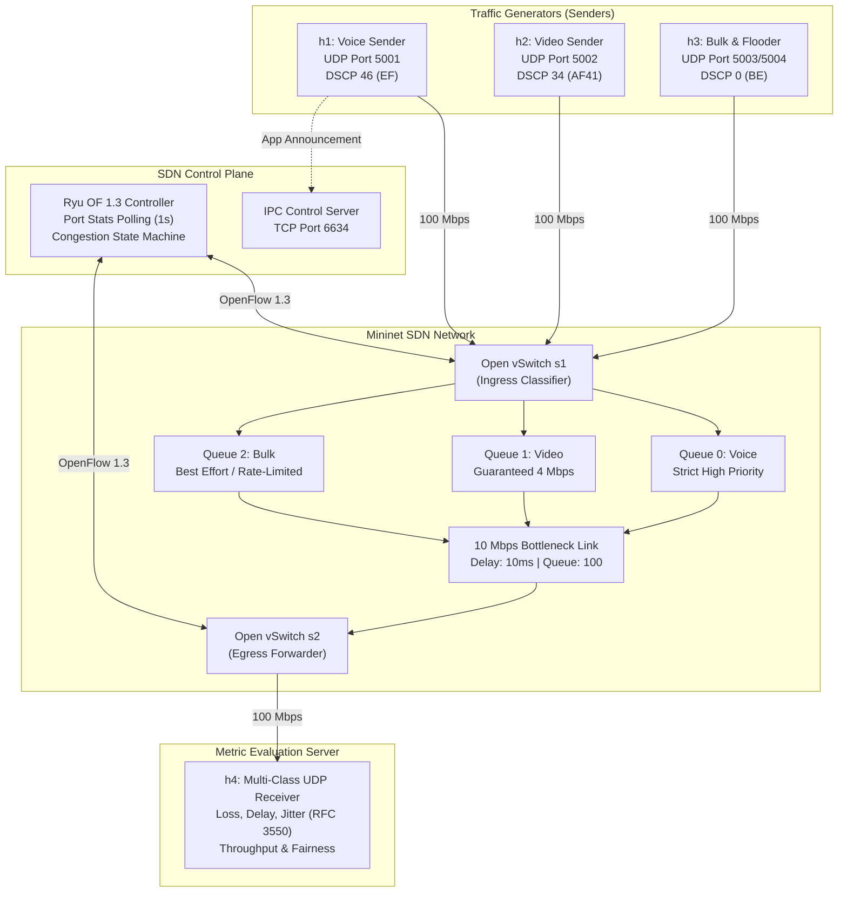
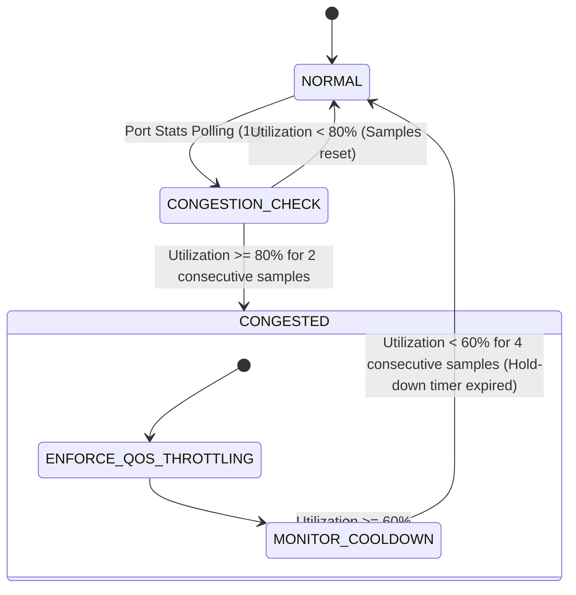

# QoS Traffic Management System - Architecture & System Design

This document details the complete end-to-end architecture, protocol framing, OpenFlow 1.3 flow matching logic, and dynamic congestion control state machine for **Team 10: QoS Traffic Management System (UDP)**.

---

## 1. End-to-End System Architecture

```
                                  +------------------------------------+
                                  |         Ryu SDN Controller         |
                                  |         (OpenFlow 1.3 App)         |
                                  |  - Dynamic Port Stats Poller (1Hz) |
                                  |  - Congestion Detector State Mach. |
                                  |  - IPC Socket Server (Port 6634)   |
                                  +-----------------+------------------+
                                                    |
                         OpenFlow 1.3 Control Plane | (FlowMod, PortStats, PacketIn)
                                                    v
+--------------------------+           +--------------------------+             +--------------------------+
|  End-Host Senders        |           |  Ingress Switch (s1)     |             |  Egress Switch (s2)      |
|                          |           |  (Open vSwitch OF 1.3)   |             |  (Open vSwitch OF 1.3)   |
| [h1] Voice Generator     +--Port 1-->|                          |             |                          |
|      (10.0.0.1, Q0, EF)  |           | +----------------------+ |             |                          |
|                          |           | | Linux HTB Queues     | |             |                          |
| [h2] Video Streaming     +--Port 2-->| | Q0: Voice  (Min 1M)  | +-s1-eth4---->|--Port 1                  |
|      (10.0.0.2, Q1, AF41)|           | | Q1: Video  (Min 4M)  | | 10 Mbps     |                          +--Port 2--> [h4] QoS Receiver
|                          |           | | Q2: Bulk   (Max 5M)  | | Bottleneck  |                          |            (10.0.0.4)
| [h3] Bulk / Congestion   +--Port 3-->| +----------------------+ | 10ms Delay  |                          |            Multi-Class
|      (10.0.0.3, Q2, BE)  |           |                          | Buffer: 100 |                          |            UDP Server
+--------------------------+           +--------------------------+             +--------------------------+
             |                                                                                ^
             +------------------- Low-Level Custom UDP Sockets -------------------------------+
                                 (Port 5001, 5002, 5003, 5004)
```

### Mermaid Sequence / Architecture View



---

## 2. Multi-Class Traffic Specification & SLA Table

| Class Name | Port | Packet Size (B) | Target Rate | Priority | DSCP / TOS | OVS Queue | SLA Expectation Under Congestion |
| :--- | :--- | :--- | :--- | :--- | :--- | :--- | :--- |
| **Voice (VoIP)** | `5001` | 160 B | 64 kbps (50 pps) | 1 (High) | 46 / `0xb8` (EF) | `Queue 0` | Loss = 0.0%, Latency < 15ms, Jitter < 1.0ms. Strict priority forwarding. |
| **Video Stream** | `5002` | 1024 B | 2.5 Mbps (305 pps) | 2 (Medium)| 34 / `0x88` (AF41)| `Queue 1` | Loss < 1.0%, Latency < 25ms, Jitter < 4.0ms. Guaranteed bandwidth share. |
| **Bulk Data** | `5003` | 1400 B | 2.0 Mbps (178 pps) | 3 (Low) | 0 / `0x00` (BE) | `Queue 2` | Absorbs backpressure; throttled dynamically when congestion is detected. |
| **Congestion Flooder** | `5004` | 1400 B | 10.0 Mbps (892 pps)| 4 (None) | 0 / `0x00` (BE) | `Queue 2` | Artificial stress flow to overload the 10 Mbps bottleneck link. |

---

## 3. Low-Level UDP Protocol Packet Framing

All application packets are generated using Python's standard `socket` module with raw binary serialization using `struct.pack`:

```
 0                   1                   2                   3
 0 1 2 3 4 5 6 7 8 9 0 1 2 3 4 5 6 7 8 9 0 1 2 3 4 5 6 7 8 9 0 1
+-+-+-+-+-+-+-+-+-+-+-+-+-+-+-+-+-+-+-+-+-+-+-+-+-+-+-+-+-+-+-+-+
|       Magic: 'Q' 'S'          |    Version    |   Class ID    |
+-+-+-+-+-+-+-+-+-+-+-+-+-+-+-+-+-+-+-+-+-+-+-+-+-+-+-+-+-+-+-+-+
|                    Sequence Number (uint32)                   |
+-+-+-+-+-+-+-+-+-+-+-+-+-+-+-+-+-+-+-+-+-+-+-+-+-+-+-+-+-+-+-+-+
|                                                               |
+                    Send Timestamp (double, 8B)                +
|                                                               |
+-+-+-+-+-+-+-+-+-+-+-+-+-+-+-+-+-+-+-+-+-+-+-+-+-+-+-+-+-+-+-+-+
|      Payload Length (uint16)  |    Payload / Padding ...      |
+-+-+-+-+-+-+-+-+-+-+-+-+-+-+-+-+                               +
|                                                               |
+-+-+-+-+-+-+-+-+-+-+-+-+-+-+-+-+-+-+-+-+-+-+-+-+-+-+-+-+-+-+-+-+
```

### Binary Packing Format:
- **Format String:** `!2sBBIdH` (Network Big-Endian, 18-byte fixed header)
  - `!2s`: 2 Bytes Magic identification (`b'QS'`)
  - `B`: 1 Byte Protocol Version (`1`)
  - `B`: 1 Byte Traffic Class ID (`1`=Voice, `2`=Video, `3`=Bulk, `4`=Flooder)
  - `I`: 4 Bytes Unsigned Integer Sequence Number (`0` to `4,294,967,295`)
  - `d`: 8 Bytes IEEE 754 Floating-point Send Timestamp (`time.time()`)
  - `H`: 2 Bytes Payload Length

---

## 4. Dynamic Congestion State Machine

The Ryu SDN controller actively samples port statistics on the bottleneck interface (`s1-eth4`) every 1.0 second:



### Policy Actions:
1. **NORMAL State:**
   - Voice packets matched on UDP port `5001` -> `OFPActionSetQueue(0)`
   - Video packets matched on UDP port `5002` -> `OFPActionSetQueue(1)`
   - Bulk packets matched on UDP port `5003` -> `OFPActionSetQueue(2)`
2. **CONGESTED State (Utilization > 80%):**
   - High priority Queue 0 and Queue 1 remain uninhibited.
   - Bulk flows (Queue 2) are dynamically rate-limited/throttled via flow rule modification.
3. **RECOVERY / RELAX State (Utilization < 60% for 4 seconds):**
   - Hold-down timer prevents oscillation/route-flapping (hysteresis).
   - Once traffic stabilizes, rules are restored to standard allocations.
